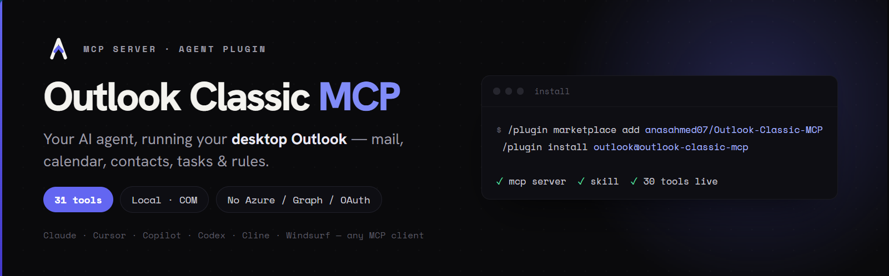
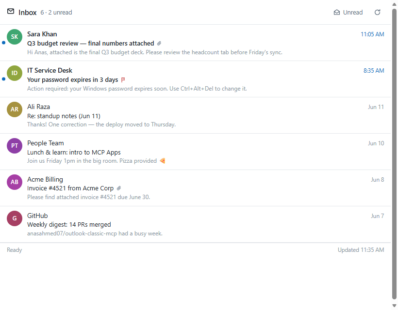
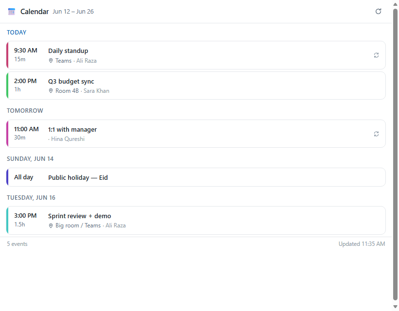

# outlook-classic-mcp



A local **MCP (Model Context Protocol) server** that exposes the **classic
Outlook desktop client** — mail, folders, calendar, contacts, tasks, color
categories, mail rules, and Out-of-Office status — to any MCP-aware
agent: Claude Code, Claude Desktop, Cowork, GitHub Copilot / VS Code
agent mode, Cursor, Cline, Continue, Windsurf, and anything else that
speaks MCP.

It talks to Outlook's COM API on Windows via `pywin32`, the same path
macros and Office add-ins use. Authentication piggybacks on whatever
account Outlook is already signed into — **no Azure / Entra app
registration, no Microsoft Graph API, no OAuth tokens.** That also means
it works the same with on-premises Exchange, ADFS or any other sign-in
Outlook itself handles.

This is a fork of [anasahmed07/Outlook-Classic-MCP](https://github.com/anasahmed07/Outlook-Classic-MCP)
that adds threaded reply/forward drafts, sending a reviewed draft,
signatures, draft-only mode **on by default**, other people's calendars
and a scheduling assistant, fuller calendar support, and the
fixes from the upstream pull requests that were still waiting to be
merged. See [What's different in this fork](#whats-different-in-this-fork).

---

## Requirements

- Windows 10 or 11
- **Outlook desktop (Classic)** — the `OUTLOOK.EXE` shipped with
  Microsoft 365 / Office. The "new Outlook" (`olk.exe`) is **not**
  supported (no COM surface).
- Python 3.10+ (the installer fetches Python 3.11 via `uv` if you
  don't already have one).

You do **not** need to open Outlook before starting the server — the
server auto-launches Outlook on its first COM call.

---

## Install

### Option 1 — Claude Code plugin (recommended)

This repository is a Claude Code **plugin marketplace**. In Claude Code on
the Windows machine with classic Outlook:

```text
/plugin marketplace add Heknon/outlook-classic-mcp
/plugin install outlook@outlook-classic-mcp
```

Restart Claude Code. That's all — nothing to install beforehand. The
plugin brings:

- the MCP server (all `outlook_*` tools),
- the [`outlook` skill](#agent-skill) that teaches the agent how to use them,
- a start-up hook that sets up the runtime the first time: it installs
  [`uv`](https://docs.astral.sh/uv/) for your user if it's missing, and uv
  downloads a suitable Python and the dependencies into the plugin's data
  folder. No admin rights needed. If `uv` can't be downloaded (blocked by
  the network or script policy), an installed Python 3.10+ is used
  instead. Corporate TLS inspection is handled by trusting the Windows
  certificate store.

The first start takes a minute or so while this happens. If the Outlook
tools don't show up in that first session, run `/mcp` and reconnect
`plugin:outlook:outlook`, or restart Claude Code. Later starts are instant.
Confirm with `outlook_whoami`.

Updating: `/plugin marketplace update outlook-classic-mcp`, then
`/plugin update outlook@outlook-classic-mcp`. Uninstalling the plugin
removes its environment too.

Settings go in `~/.claude/settings.json` under `"env"` (for example
`"OUTLOOK_MCP_ALLOW_SEND": "1"`), see [Environment variables](#conventions).
Launcher-only switches: `OUTLOOK_MCP_RUNTIME=python` (never use uv) and
`OUTLOOK_MCP_NO_AUTO_INSTALL=1` (don't download uv).

### Option 2 — From a clone (any MCP client)

```bat
git clone https://github.com/Heknon/outlook-classic-mcp
cd outlook-classic-mcp
install.bat
```

`install.bat` creates a `.venv`, installs the package, and runs the
client installer below to register the server with Claude Desktop,
Claude Code, Cursor, Cline, Continue or Windsurf.

### Option 3 — Manual registration

```powershell
claude mcp add outlook -- uvx --from git+https://github.com/Heknon/outlook-classic-mcp outlook-mcp
```

Append `@<commit or tag>` to the URL to pin a version. For other clients
see [Manual config](#manual-config-any-other-mcp-client).

---

## Smart client installer

`scripts/install_to_clients.py` detects which MCP clients are
installed on your machine and shows a checkbox menu:

```
Select which clients to register outlook-mcp with:
  [ ] 1. Claude Desktop      C:\Users\you\AppData\Roaming\Claude\claude_desktop_config.json
  [ ] 2. Claude Code         (via `claude` CLI)
  [ ] 3. Cursor              C:\Users\you\.cursor\mcp.json

Type a number to toggle, 'a' to select all, 'n' for none,
'enter' to confirm, 'q' to quit without changes.
```

For each toggled client it deep-merges
`mcpServers.outlook = {"command": ".venv/Scripts/python.exe", "args": ["-m", "outlook_mcp"]}`
into the right config (or runs `claude mcp add` for Claude Code).
Existing files are snapshotted to `<file>.bak` first. Re-running is
idempotent — it updates the entry instead of duplicating it.

Supported clients: **Claude Desktop, Claude Code, Cursor, Cline,
Continue, Windsurf.**

### Manual config (any other MCP client)

Any client not covered by the installer just needs the standard stdio
server entry in its MCP config:

```json
{
  "mcpServers": {
    "outlook": {
      "command": "uvx",
      "args": ["--from", "git+https://github.com/Heknon/outlook-classic-mcp", "outlook-mcp"]
    }
  }
}
```

(VS Code / Copilot agent mode names the top-level key `servers` in
`mcp.json` instead of `mcpServers`; the entry itself is the same. To let
the server send, add `"env": { "OUTLOOK_MCP_ALLOW_SEND": "1" }` — see
[Safety](#safety-drafts-first).)

---

## Tools

37 tools across 9 categories, all prefixed `outlook_*`.

| Category       | Tools |
| -------------- | ----- |
| Mail           | `list_mails`, `search_mails`, `search_mails_by_person`, `get_mail`, `send_mail`, `reply_mail`, `forward_mail`, `send_draft`, `list_signatures`, `move_mail`, `delete_mail`, `mark_mail`, `save_attachments` |
| Folders        | `list_folders`, `create_folder`, `list_mailboxes` |
| Calendar       | `list_events`, `get_event`, `create_event`, `update_event`, `delete_event`, `respond_event`, `get_free_busy`, `find_meeting_times` |
| Contacts       | `list_contacts`, `search_contacts` (saved contacts + org directory), `get_contact`, `resolve_name` (Ctrl+K: name → address, with candidates when ambiguous) |
| Tasks          | `list_tasks`, `create_task`, `complete_task` |
| Categories     | `list_categories`, `set_category` |
| Rules          | `list_rules`, `toggle_rule` |
| Out-of-Office  | `get_out_of_office` |
| Account        | `whoami` — sanity check; shows the bound mailbox |

### Searching everywhere

`search_mails` and `search_mails_by_person` search one folder by default.
With `search_in` they search every folder of:

- `"mailbox"` — your mailbox,
- `"archive"` — your online / in-place archive,
- `"all"` — every mailbox in your Outlook profile: yours, the archive,
  shared and delegate mailboxes, and PST files,

or `mailboxes=["Support"]` for specific ones (`list_mailboxes` lists
them). Results are newest first and show the folder path of each mail.
Deleted Items and Junk are skipped unless `include_deleted=true`. The
archive and shared mailboxes must be open in Outlook's folder pane.

### People

- `resolve_name` works like **Ctrl+K**: give it a full or partial name or
  alias and get the person's address, title, department and office. If
  several people match, it returns the candidates to choose from.
- `search_mails_by_person(person="Dana", direction="from")` finds mails
  from and/or to someone by name, across Inbox and Sent Items.

### Drafting

- `send_mail`, `reply_mail` and `forward_mail` all take `save_only=true`
  to save to Drafts instead of sending. Reply and forward drafts are real
  Outlook replies: threaded, with the quoted history and its formatting
  intact. The result includes the draft's `entry_id`.
- `send_draft(entry_id)` sends a draft once you've reviewed it.
- Reply text goes *inside* the message body, above the quoted original,
  so it uses the message's own font and spacing.
- Replies and forwards can add To/CC/BCC recipients, change the subject,
  and set importance.
- `signature=true` adds your default Outlook signature (the reply/forward
  default for replies — not added twice if Outlook already put one in);
  `signature="<name>"` picks a saved signature (`list_signatures` lists
  them). Signature images are embedded.
- Recipients are resolved before saving or sending; a send with
  unresolvable names is refused instead of failing inside Outlook.

### Calendar

- **Other people's calendars:** `list_events(mailbox="ann@corp.com")`
  reads a colleague's calendar if they've shared it with you (or you're
  their delegate).
- **Free/busy for anyone:** `get_free_busy(people=[...])` shows when
  people are busy, tentative or out of office, from Exchange free/busy —
  no calendar permission needed, like Outlook's Scheduling Assistant.
- **Find a time:** `find_meeting_times(attendees=[...], duration_minutes=60)`
  returns slots when you and every required attendee are free, within
  working hours (`day_start`/`day_end`) and working days
  (`working_days=["sun","mon","tue","wed","thu"]` for a Sunday–Thursday
  week). Optional attendees who'd miss a slot are listed with it.
- All-day events (`all_day=true`, dates only).
- Meetings can be saved without sending invitations (`send_invites=false`).
- `update_event` changes only your calendar unless `send_update=true`;
  it can add and remove attendees.
- Deleting a meeting you organize sends a cancellation first
  (`send_cancellation=false` to skip).
- Recurring meetings: pass `occurrence_start` to change, delete or
  respond to a single occurrence. Changing a whole series needs
  `apply_to_series=true`, so "move tomorrow's standup" can't move all of
  them by accident.
- Meeting responses can include a comment.

---

## Safety: drafts first

**By default the server cannot send anything.** Compose tools always save
to Drafts, `send_draft` is refused, meeting invites and updates are saved
unsent, cancellations are refused, and meeting responses wait in Drafts.
You review and send from Outlook.

To let it send, set `OUTLOOK_MCP_ALLOW_SEND=1` in the server's
environment. `OUTLOOK_MCP_DRAFT_ONLY=1` always forces draft-only, even if
sending is allowed elsewhere (useful for IT-managed configs).

In Claude Code you can also gate individual tools. For example, in
`.claude/settings.json` (tool names below are for a server registered
manually as `outlook`; installed as the plugin they are
`mcp__plugin_outlook_outlook__outlook_...` — `/mcp` shows the real names):

```json
{
  "permissions": {
    "allow": [
      "mcp__outlook__outlook_whoami",
      "mcp__outlook__outlook_list_mails",
      "mcp__outlook__outlook_search_mails",
      "mcp__outlook__outlook_get_mail",
      "mcp__outlook__outlook_list_folders",
      "mcp__outlook__outlook_list_events",
      "mcp__outlook__outlook_get_event",
      "mcp__outlook__outlook_list_signatures"
    ],
    "deny": [
      "mcp__outlook__outlook_delete_mail",
      "mcp__outlook__outlook_toggle_rule"
    ]
  }
}
```

Everything not listed asks for approval each time.

Email bodies are written by other people and end up in the model's
context, so treat them as untrusted input — another reason to keep
sending behind a review step.

---

## MCP Apps — interactive UI in the chat

Since v0.3.0 the server implements the [MCP Apps extension](https://modelcontextprotocol.io/extensions/apps/overview)
(SEP-1865): read tools ship a self-contained HTML view that supporting
hosts (Claude, Claude Desktop, VS Code Copilot, Goose, Postman, …)
render in a sandboxed iframe right inside the conversation — instead of
a wall of text you get a real inbox, agenda, or contact list. Hosts
without MCP Apps support are unaffected and keep getting the usual
markdown.



| View | Rendered by | What you can do in it |
| ---- | ----------- | --------------------- |
| Mail list | `list_mails`, `search_mails` | open mails in a reading pane, mark read/unread, flag, delete, filter unread, refresh |
| Mail reader | `get_mail` | full body + attachment list, mark, flag, delete |
| Calendar agenda | `list_events` | day-grouped agenda, expand an event for attendees + body, refresh |
| Contacts | `list_contacts`, `search_contacts` | live search (incl. org directory), copy addresses |
| Tasks | `list_tasks` | complete tasks, quick-add new ones, show completed, refresh |



The views are plain inline HTML/CSS/JS (no build step, no external
CDNs — the sandbox CSP blocks those anyway), follow the host's
light/dark theme, and talk back over the standard `postMessage`
JSON-RPC dialect: buttons in the UI call the same `outlook_*` tools the
model uses, and in-app actions (delete, complete, …) are reported back
into the model's context so the conversation stays in sync.

Technically: each UI tool carries `_meta.ui.resourceUri` pointing at a
`ui://outlook/*.html` resource (mime `text/html;profile=mcp-app`) and
returns markdown for the model **plus** `structuredContent` for the
app. To preview the views without an MCP host:
`python scripts/preview_ui.py`, then open
`.ui-preview/harness.html?view=mail-list` (any view name, optional
`&theme=dark`) in a browser.

---

## Agent skill

The repo also ships an agent **skill** at `skills/outlook/` (standard Agent Skills format — works in Claude Code, Cowork, Copilot, Cursor, and other agents that load skills) — a self-contained operational reference that teaches the agent how to drive the `outlook_*` tools correctly: folder reference syntax, the `EntryID` handle pattern, ISO-8601 date conventions, the `Recurrence` object, which calls have side effects to confirm before, and 19 worked recipes for common workflows (triage, drafting replies, weekly digests, scheduling meetings, recurring events, attachment handling, multi-mailbox setups).

Layout:

```
skills/outlook/
├── SKILL.md                  # always-loaded operational core
└── references/               # loaded on demand
    ├── tools.md              # full per-tool parameter / return-shape reference
    ├── recipes.md            # worked multi-step workflows
    ├── gotchas.md            # quirks + failure modes (Programmatic Access prompt, EX:/O= addresses, live rule toggling, sandboxed paths, etc.)
    └── setup.md              # install instructions an agent can walk a user through when the tools aren't connected yet
```

Installing the [plugin](#option-1--claude-code-plugin-recommended) auto-loads this skill alongside the MCP server. For an agent that supports skills but not plugins, copy the `skills/outlook/` directory into wherever it loads skills from.

---

## Conventions

**Folder references** can be:

- A well-known name: `inbox`, `sent`, `drafts`, `deleted`, `outbox`,
  `junk`, `calendar`, `contacts`, `tasks`, `notes`
- A slash path: `Inbox/Projects/Acme`
- A path qualified by store name: `Mailbox - you@example.com/Inbox/Projects/Acme`

Use `outlook_list_folders` to discover paths.

**Dates / times** are ISO-8601 strings. Inputs without a timezone are
treated as local time (what Outlook stores); returned timestamps carry
the user's local UTC offset explicitly (`2026-06-10T16:33:22+05:00`).

**Item IDs** are Outlook `EntryID` strings. Read tools return them
on every item; pass them back to detail / edit / delete tools.

**Response format** — most read tools accept `response_format`:
- `markdown` (default) — pretty rendered output
- `json` — full structured data

**Errors** are raised, so the MCP host marks the response
`isError: true`. Error messages try to suggest a corrective next step.

**Filesystem paths** for `attachments=` and `output_dir=` must be
absolute and under the user profile (default sandbox). Add other folders
with `OUTLOOK_MCP_ALLOWED_PATHS` (`;`-separated), or set
`OUTLOOK_MCP_ALLOW_ANY_PATH=1` to disable the sandbox entirely.

**Environment variables**

| Variable | Effect |
| -------- | ------ |
| `OUTLOOK_MCP_ALLOW_SEND=1` | Allow sending. Off by default: everything is saved as a draft; see [Safety](#safety-drafts-first). |
| `OUTLOOK_MCP_DRAFT_ONLY=1` | Force draft-only even if sending is allowed. |
| `OUTLOOK_MCP_ALLOWED_PATHS` | Extra folders for attachments / saved attachments. |
| `OUTLOOK_MCP_ALLOW_ANY_PATH=1` | Disable the path sandbox. |
| `OUTLOOK_MCP_SIGNATURES_DIR` | Signatures folder, if not `%APPDATA%\Microsoft\Signatures`. |
| `OUTLOOK_MCP_LOG` | Log level (`DEBUG`, `INFO`, ...). |

---

## Architecture

```
                  +-------------------+
   stdio  <--->   |  FastMCP server   |   <-- one per process
                  +---------+---------+
                            |
                  await bridge.call(...)
                            |
                            v
                  +-------------------+
                  | OutlookBridge     |   persistent STA thread
                  | - one Dispatch    |   single Outlook.Application
                  | - work queue      |   handle, reused by every call
                  +---------+---------+
                            |
                  Outlook COM (auto-launches OUTLOOK.EXE if needed)
```

The MCP event loop never blocks on COM, and COM only ever sees the
one STA thread it needs. This is faster than per-call dispatch and
the Outlook process stays warm across calls.

---

## Development

```bat
.venv\Scripts\activate
pip install -e .[dev]
pytest
```

Smoke test the running server with the MCP inspector:

```bat
npx @modelcontextprotocol/inspector .venv\Scripts\python.exe -m outlook_mcp
```

> The inspector mangles backslashes on Windows — use forward-slash
> paths if you hit "ENOENT" errors.

To check everything against your real Outlook (draft-only is forced, and
the one test draft and test appointment it creates are deleted after):

```bat
.venv\Scripts\python scripts\smoke_test.py --with colleague@yourcompany.com
```

Tests mock COM, so they run on any OS (`tests/conftest.py` stubs
`pywin32` off Windows; a handful of bridge tests need real pywin32 and
only run on Windows). CI runs both.

---

## Notes & caveats

- The first call after a cold start takes a few seconds — Outlook's
  COM surface boots up. After that, calls are fast (one Dispatch
  handle is reused).
- Closing Outlook while the server is running is fine: the next tool
  call detects the dead COM connection, relaunches OUTLOOK.EXE,
  reconnects, and retries automatically (expect that one call to take
  15–30 s).
- Outlook auto-launch relies on standard COM behavior. On
  tightly-locked-down machines (UAC, group policy blocking COM
  activation), open Outlook manually and try again.
- Send / reply / forward / delete may trigger Outlook's "Programmatic
  Access" security prompts on some corporate machines. If your IT
  policy blocks programmatic send entirely, write tools will fail —
  read tools still work. Resolving recipients against the address book
  can trigger the same prompt.
- Some properties (e.g. `SenderEmailAddress` for Exchange addresses)
  come back as `EX:/O=...` distinguished names rather than SMTP. Use
  `from_address` substring matching instead of exact equality — or
  `search_mails(scope='from')`, which also matches the real SMTP
  address.
- Toggling mail rules modifies live rules immediately — there is no
  staging buffer. Confirm the rule name with `outlook_list_rules`
  before calling `outlook_toggle_rule`.
- This server is **local-only**. Do not expose it over a network.

---

## Troubleshooting

**"Outlook COM thread did not become ready"** — Outlook didn't
auto-launch. Open it manually, sign in, then restart the MCP client
so it re-spawns the server.

**Inspector shows ENOENT for the python path** — known Windows
quirk; use forward slashes (`C:/Users/you/...`) instead of
backslashes.

**Send / reply gets blocked silently** — Outlook → File → Options →
Trust Center → Programmatic Access. The setting that works while
you're using the server is "Never warn me about suspicious activity
(not recommended)" — or have IT add the Python interpreter as a
trusted publisher.

---

## What's different in this fork

Merged from upstream pull requests that were open at the time:

- [#19](https://github.com/anasahmed07/Outlook-Classic-MCP/pull/19) — event and task times were written one UTC offset early.
- [#11](https://github.com/anasahmed07/Outlook-Classic-MCP/pull/11) — date filters broke on non-US date formats; multi-day events were missed; attachment errors failed whole mail reads; faster failure while Outlook reconnects.
- [#16](https://github.com/anasahmed07/Outlook-Classic-MCP/pull/16) — recipients resolved before saving drafts.
- [#18](https://github.com/anasahmed07/Outlook-Classic-MCP/pull/18) — send from a chosen account; default signature on new mail.

Added here (mostly from [upstream issue #13](https://github.com/anasahmed07/Outlook-Classic-MCP/issues/13)):

- Reply and forward drafts (`save_only`), `send_draft`, and draft-only mode
  (on by default).
- Other people's calendars, free/busy lookup and a meeting-time finder.
- Reply/forward text inserted inside the HTML body instead of before `<html>`;
  plain-text replies no longer flatten an HTML thread.
- To/CC/BCC, subject and importance on replies and forwards.
- Named signatures, default reply signatures, embedded signature images.
- All-day events, unsent meetings, meeting updates and cancellations,
  attendee changes, single-occurrence edits and the series guard,
  busy status, optional attendees, response comments.
- Date filters (which Outlook evaluates in UTC) now convert local times
  to UTC, so "since this morning" means this morning.
- `OUTLOOK_MCP_ALLOWED_PATHS` for attachment folders outside the profile.

See [CHANGELOG.md](CHANGELOG.md) for details.

---

## License

MIT — original work © Anas Ahmed Shaikh, fork changes © Ori Harel.

